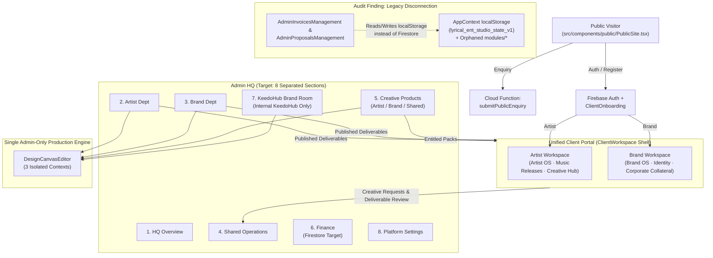

# KeedoHub — Master Product & Engineering Documentation

> **Official Positioning:** KeedoHub is a creative ecosystem and production platform serving **artists** and **brands**. It provides a structured environment for creative requests, creative production, asset management, professional documents, client collaboration, and delivery. KeedoHub is **not** primarily a campaign-management platform.

---

## 1. Documentation Index

| Document | Focus & Scope |
|---|---|
| [Product Architecture](docs/PRODUCT_ARCHITECTURE.md) | One platform, two client experiences (`Artist` & `Brand`), one Admin HQ, auth, onboarding, normalization, RBAC. |
| [Artist Workspace](docs/ARTIST_WORKSPACE.md) | Live Artist OS vs. planned dashboard, release readiness, EPK, Artist documents, legacy Lyrical music feature integration. |
| [Brand Workspace](docs/BRAND_WORKSPACE.md) | Brand OS (absorbing all commercial/business entities), brand tokens & guidelines, Brand creative catalogue. |
| [Admin HQ](docs/ADMIN_HQ.md) | Transition from the current 18-item flat nav to the target **8-section** separated Admin HQ. |
| [Creative Production Lifecycle](docs/CREATIVE_PRODUCTION.md) | End-to-end 13-stage workflow, approval gates, version history, and 3-layer asset model. |
| [Canvas & Template System](docs/CANVAS_AND_TEMPLATE_SYSTEM.md) | Single Admin-only `DesignCanvasEditor`, 3 isolated studio contexts, storage isolation, export verification. |
| [Documents & Finance](docs/DOCUMENTS_AND_FINANCE.md) | Artist vs. Brand document vaults, `localStorage` vs. Firestore split-brain audit, document write vulnerability. |
| [Payments & Subscriptions](docs/PAYMENTS_AND_SUBSCRIPTIONS.md) | Honest gap analysis (`PLANNED` / not implemented), Paystack evaluation candidate, webhooks, entitlements. |
| [KeedoHub Brand Room](docs/BRAND_ROOM.md) | Strictly internal-only KeedoHub marketing studio, Collection 001, isolation from Client Brand Dept. |
| [Lyrical Migration & Cleanup](docs/LYRICAL_MIGRATION_AND_CODE_CLEANUP.md) | Purging legacy Lyrical client identity, dual-read account normalization, safe dead-code cleanup inventory. |
| [Data, Security & Firebase](docs/DATA_SECURITY_AND_FIREBASE.md) | Firebase Auth, named Firestore DB, Storage, Cloud Functions, rules, entitlement & schema drift risks. |
| [Implementation Roadmap](docs/IMPLEMENTATION_ROADMAP.md) | Agreed Phase 0 → Phase 6 sequence with dependencies, risks, tests, and exit gates. |
| [Testing & Release Policy](docs/TESTING_AND_RELEASE_POLICY.md) | 8-tier verification taxonomy, emulator vs. build guarantees, explicit-approval deployment policy. |

**Existing Operational Guides (Root):**
- [ADMIN_SETUP.md](ADMIN_SETUP.md) — Admin authentication setup, temporary Email/Password test setup, and preview domain Google Auth steps.
- [QA_SETUP.md](QA_SETUP.md) — Local Firebase Emulator Suite & PowerShell QA test runner guide.

---

## 2. Brand & Product Identity

- **Product Name:** **KeedoHub**
- **Visual Identity (Locked):**
  - Primary Accent: `#FF1E1E` (Red)
  - Primary Surface: `#080808` (Black)
  - Primary Foreground: `#FFFFFF` (White)
- **Target Client Model:**
  - **1. Artist** — Recording artists, solo musicians, and performers requiring release artwork, streaming platform packs, motion visualizers, lyric videos, EPKs, and music-production agreements.
  - **2. Brand** — Commercial brands, startups, corporate organizations, businesses, record labels, agencies, and founders requiring identity systems, brand guidelines, collateral, commercial documents, and promotional assets.
  - *Policy Decision:* There is **no third Company, Business, Agency, Label, Enterprise, or Personal client experience** in the target architecture. Commercial business needs live inside **Brand**. Historical records using legacy account types are preserved and normalized safely via dual-read transitions ([docs/LYRICAL_MIGRATION_AND_CODE_CLEANUP.md](docs/LYRICAL_MIGRATION_AND_CODE_CLEANUP.md)).

---

## 3. System Overview (Current vs. Target Architecture)

---

## 4. How Key Subsystems Operate

### 4.1 Client Experience (`IMPLEMENTED — RUNTIME VERIFICATION PENDING` with `PLANNED` upgrades)
- Clients sign in via Email/Password or Google Auth (`src/components/auth/`), complete onboarding (`ClientOnboarding.tsx`), and enter `ClientWorkspace.tsx`, which hosts `ClientCreativeHub.tsx` and `ClientStudio.tsx`.
- **Current Gap:** Onboarding (`RegisterPage.tsx`, `ClientOnboarding.tsx`) and `clientOS.ts` still expose a 3rd `'Company'` option (cosmetic `"Business OS"` label over identical Brand UI). Invoices/proposals (`ClientStudio.tsx`) write to `workspaces/{workspaceId}/documents`, while `Artist OS` omits a structured Artist Document Vault in sidebar navigation.

### 4.2 Admin HQ (`IMPLEMENTED — RUNTIME VERIFICATION PENDING` as 18 items; 8-Section Structure is `PLANNED`)
- **Current (`src/components/admin/AdminHQ.tsx`):** 6 navigation groups containing 18 tabs (`hq-overview`, `brand-room`, `clients-accounts`, `workspaces`, `services-packages`, `production-studio`, `projects`, `deliverables-reviews`, `creative-requests`, `creative-products`, `design-library`, `invoices-payments`, `proposals`, `business-documents`, `admin-management`, `security-access`, `audit-history`, `platform-settings`).
- **Planned:** Reorganize into **8 departmentally separated sections** so Artist operations, Brand operations, Shared Triage, Creative Products, Firestore Finance, Internal Brand Room, and Governance no longer mix.

### 4.3 Creative Production, Canvas & Brand Room Separation
- **Creative Production (`IMPLEMENTED — RUNTIME VERIFICATION PENDING`):** Clients submit requests → Admin creates/manages `clientProjects`, `productionTasks`, and internal `DesignCanvasEditor` masters → internal QA → Admin publishes approved deliverables (`isClientPublished: true`) to `clientProjects/{projectId}/deliverables/{deliverableId}` → clients preview, download, approve, or request revisions.
- **Canvas (`IMPLEMENTED — RUNTIME VERIFICATION PENDING`):** `src/components/studio/DesignCanvasEditor.tsx` (1,965 lines) is strictly **Admin-only**, verified on mount against `admins/{uid}`. Clients never open the Canvas Editor. Planned Phase 5 adds explicit `canvasMode` isolation (`Artist Client Production`, `Brand Client Production`, `Internal KeedoHub Brand Room`) and client Brand token injection.
- **Brand Room (`IMPLEMENTED — RUNTIME VERIFICATION PENDING`):** `src/components/admin/brand-room/BrandRoom.tsx` is strictly for **internal KeedoHub self-marketing** (including Collection 001, content calendar, and internal assets). It must remain decoupled from the client Brand Department and never publish unconsented client deliverables.

### 4.4 Documents, Finance & Payments (`PARTIALLY IMPLEMENTED` / `LEGACY / DISCONNECTED` / `PLANNED`)
- **Critical Split-Brain Defect (`Confirmed from code`):** `AdminInvoicesManagement.tsx`, `AdminProposalsManagement.tsx`, and `CorporateDocuments.tsx` read/write browser `localStorage` via `useApp()` (`AppContext.tsx`), completely disconnected from Firestore `workspaces/{workspaceId}/documents` used by `ClientStudio.tsx`.
- **Critical Security Vulnerability (`Confirmed from code`):** `firestore.rules` line 402 allows `read, write` by any active workspace member on `workspaces/{workspaceId}/documents/{documentId}`, enabling clients to alter commercial invoice amounts or statuses client-side.
- **Payments (`PLANNED` — `Not implemented`):** Zero payment SDKs (`stripe`, `paystack`, etc.) or HTTP webhooks exist in `package.json` or `functions/package.json`. Paystack will be evaluated for Nigerian operations alongside alternatives during Phase 6.

---

## 5. Current Technical & Firebase Architecture

| Layer | Technology / Source | Notes (`Confirmed from code`) |
|---|---|---|
| **Frontend** | React 19, Vite 8, TypeScript, Tailwind CSS v4, Lucide Icons, jsPDF, JSZip | Dev port `3000`. Uses Firebase v13 modular SDK. |
| **Backend** | Firebase Cloud Functions v1 (`functions/src/index.ts`, 1,489 lines) | 17 triggers/callables/schedules (`assertActiveAdmin`, `onDocumentWritten` audit & notifications, deadline scheduler). |
| **Named Database** | Cloud Firestore (`ai-studio-lyricalentbrandl-85ee0d5d-6fc2-41f3-a410-3e059e509c38`) | Hardcoded across `functions/src/index.ts`, `storage.rules`, `firebase.json`, and app config. **Do not rename casually.** |
| **Storage** | Firebase Storage (`storage.rules`) | Enforces 50 MB / asset MIME allowlists and cross-service Firestore checks. |
| **Legacy Persistence** | Browser `localStorage` (`lyrical_ent_studio_state_v1`) | Seeded by `src/data/initialData.ts`; 20+ orphaned UI files remain in `src/components/modules/`, `common/`, `modals/`. |

---

## 6. Current Implementation Status & Planned Restructure

- **Live & Functional (Pending Runtime Verification):** Public site, Auth, Onboarding, Client Workspace, Artist OS (profile/releases/content/assets), Brand OS (identity/guidelines PDF/content/assets), Client Creative Hub (strict entitlement matching after Phase 8.5), Admin Production Studio, Admin Design Library, Admin Creative Products, KeedoHub Brand Room, Admin Governance & Notifications.
- **Broken / Disconnected / Vulnerable:** Admin Finance (`localStorage`), Corporate Documents (`localStorage`), `workspaces/{ws}/documents` write rule (`firestore.rules:402`), `packageEntitlements` expiry ignored by Firestore/Storage rules, `firebase-blueprint.json` schema drift, legacy `'Company'`/`'Business'`/`'LYRICAL ENT'` strings.
- **Not Yet Implemented:** 8-section Admin HQ reorganization, unified Firestore invoices/proposals collections, online checkout & subscription webhooks, Artist Document Library in Client OS, automated entitlement expiry.

### Implementation Sequence Overview
1. **Phase 0:** Documentation, hygiene, dead-code purge, KeedoHub metadata rebranding.
2. **Phase 1:** `Artist` + `Brand` normalization & dual-read migration bridge.
3. **Phase 2:** Unified Firestore documents & secure Finance migration.
4. **Phase 3:** Admin HQ 8-section reorganization.
5. **Phase 4:** Distinct Artist & Brand client dashboards.
6. **Phase 5:** Canvas context isolation & Artist/Brand template catalogue separation.
7. **Phase 6:** Payments, Paystack/gateway evaluation, webhooks & subscription automation.

See [docs/IMPLEMENTATION_ROADMAP.md](docs/IMPLEMENTATION_ROADMAP.md) and [docs/TESTING_AND_RELEASE_POLICY.md](docs/TESTING_AND_RELEASE_POLICY.md) before authorizing any implementation phase.

> **Governance Reminder:** Static builds (`npm run build`) and unit tests do **not** validate live Firebase security rules or runtime browser workflows. No Firebase rules or production infrastructure may be deployed without explicit project owner approval.
